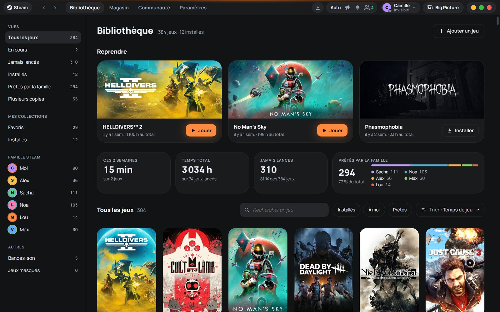
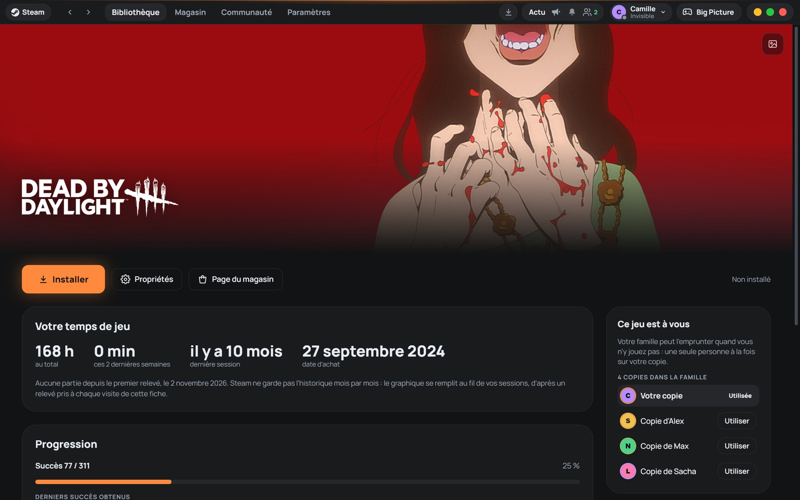
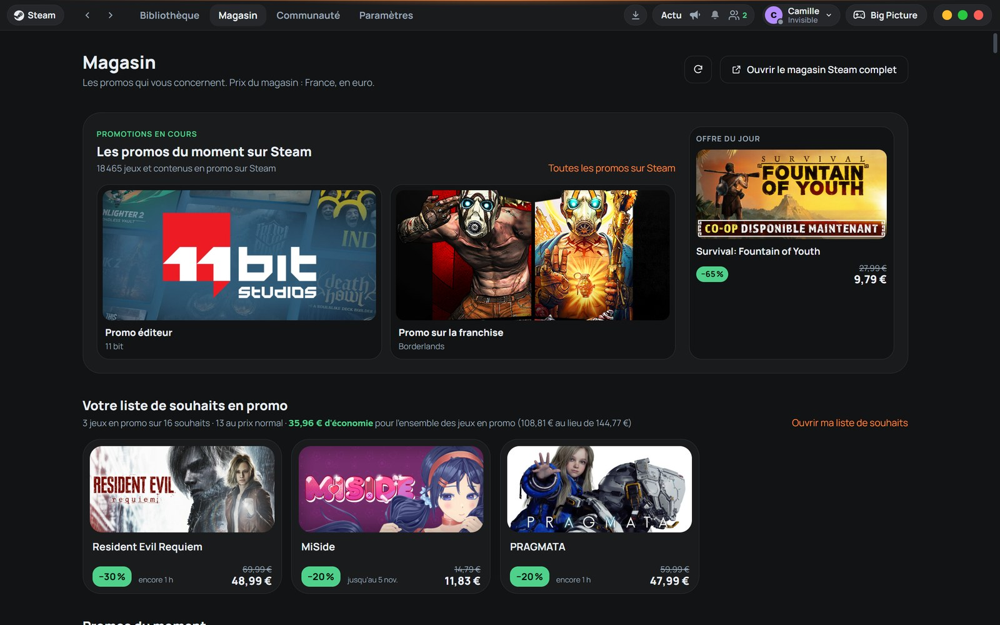
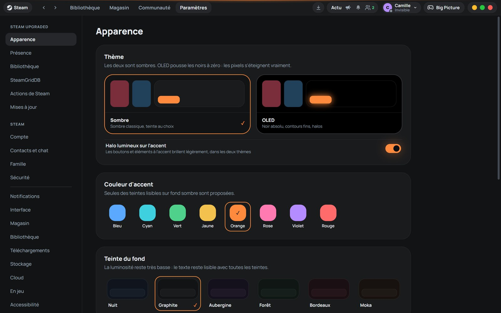
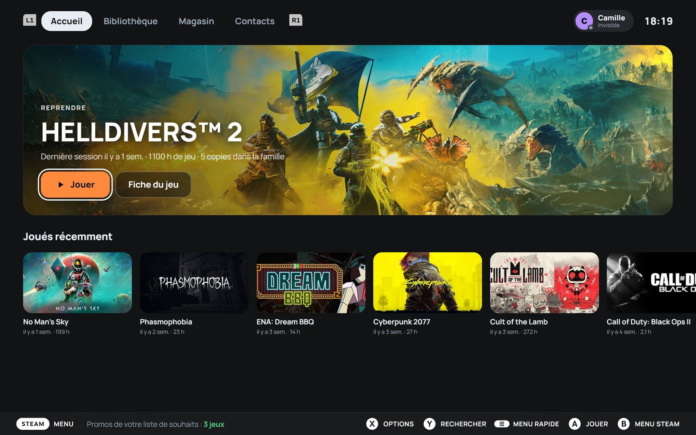
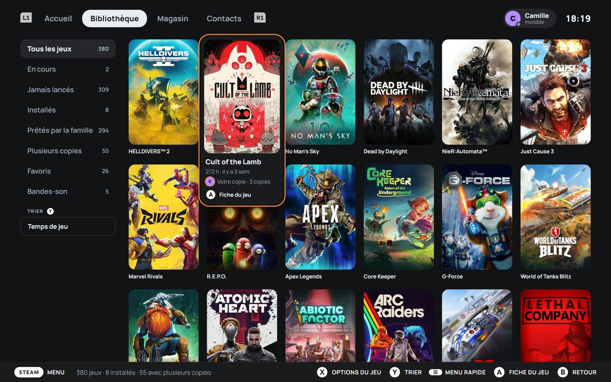
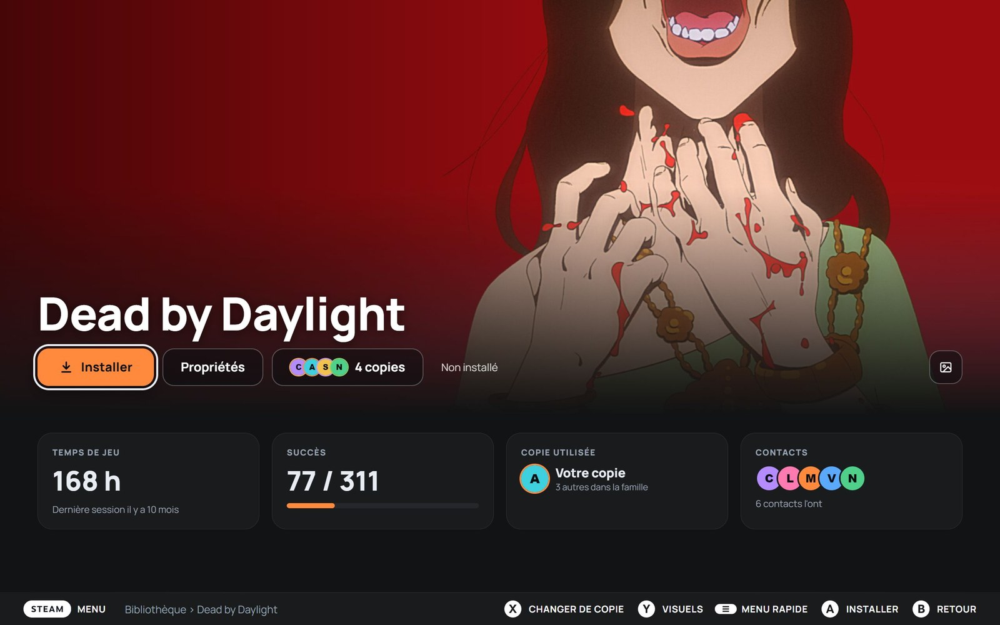
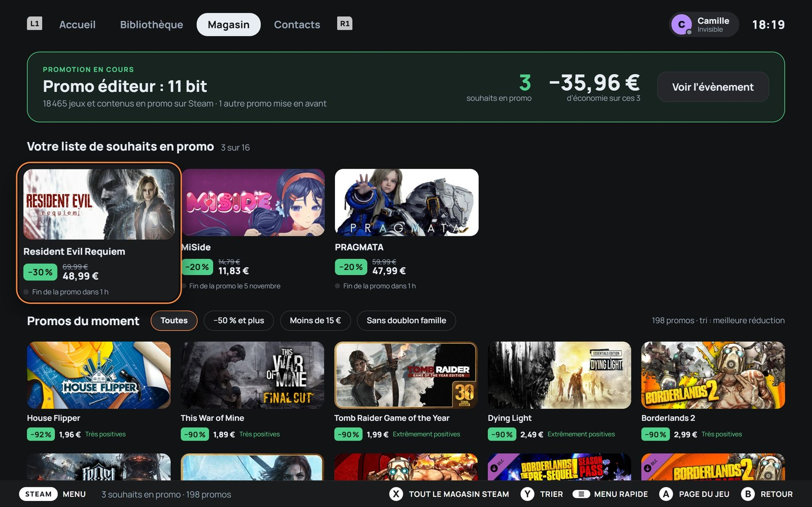

# Steam Upgraded

**A new interface for the Steam client, in desktop mode and in Big Picture.** Powered by [Millennium](https://steambrew.app/).

*[Version française](README.md)*

Steam Upgraded is a Millennium plugin that replaces Steam's interface with a fully redesigned one: library, game pages, store, settings, downloads, friends, Big Picture… Your games, your account and your Steam settings stay the same: only the display changes, and everything goes back to normal when you uninstall it.

**The interface is in French only for now.**

> Independent project, not affiliated with Valve. Steam is a trademark of Valve Corporation.



<!-- Permanent links to the latest release: every release must attach these files, with these exact names (Steam-Upgraded-Setup.exe, Steam-Upgraded-macOS.zip, com.venacity.steamupgraded.star, millennium-<tag>-macos-arm64.tar.gz). -->

## Download

**Windows 10 and 11**, with Steam installed:

- **[Download the installer for Windows](https://github.com/venaciteam/steam-upgraded/releases/latest/download/Steam-Upgraded-Setup.exe)**: it handles everything, Millennium included. If in doubt, choose this one.
- **[Download the plugin only](https://github.com/venaciteam/steam-upgraded/releases/latest/download/com.venacity.steamupgraded.star)**: if Millennium is already installed (see [Manual installation](#installation)).

**Mac with Apple silicon** (M1 or later, macOS 11 or later), with Steam installed and opened once:

- **[Download the installer for Mac](https://github.com/venaciteam/steam-upgraded/releases/latest/download/Steam-Upgraded-macOS.zip)**: it installs Millennium, the plugin and the "Steam Upgraded" app, which you now use to open Steam.

The system warning on first launch and the steps: see [Installation](#installation). All versions: [releases](../../releases).

| Game page | Store | Settings › Appearance |
| --- | --- | --- |
|  |  |  |

**In Big Picture**

| Home | Library |
| --- | --- |
|  |  |
| **Game page** | **Store** |
|  |  |

## What it brings

**Desktop mode**

- **A single top bar**: navigation, downloads, news, friends and account, instead of Steam's stacked bars and menus.
- **Library**: ready-made views (in progress, never played, installed, lent by family, multiple copies…), your collections, your Steam Family members, a "Resume" row and a grid of covers that grow on hover.
- **Game page**: banner and logo, playtime, achievements, copies available in your family (and which one to use), collections, friends who own the game.
- **Store**: the deals that matter to you, starting with your wishlist, at your country's prices; your whole wishlist (filters, sorting, add to cart) and your Steam cart (payment happens on Steam's own page).
- **One settings page**: Steam Upgraded's settings and Steam's own, side by side.
- **Steam pages and windows restyled**: downloads, menus, dialogs, properties, notifications, friends and chat, screenshots, soundtracks and music player.
- **Page transitions** and an animated opening, short, and following the system's "reduce animations" setting.

**Big Picture**

- Home, library, game pages, store, product page, wishlist and cart, achievements, downloads, search, media, soundtracks, friends and chat: screens designed for a controller, showing the buttons of your own controller (Xbox, PlayStation…).
- Steam's remaining native menus and screens (settings, properties, Steam menu, quick access, virtual keyboard) are restyled in the same colors.

**Customization**

- Two dark themes: **Dark** and **OLED** (pure black).
- Eight accent colors and six background tints, all chosen to stay readable.
- Squircle corners, accent glow, HDR support.
- **SteamGridDB artwork**: pick the cover, banner, logo, wide capsule and icon of each game, with your own (free) SteamGridDB key.

## A few deliberate choices

- **Nothing is ever drawn over a cover**: no badges or text; information goes below, or in the card shown on hover.
- **Dark themes only.**
- **Valve's web pages** (Community, profiles, full store) stay as they are: restyling them would break with every Valve update.
- **No made-up numbers**: when data doesn't exist (price history, for example), it isn't shown.

## Installation

You need Steam, on Windows 10 or 11, or on a Mac with Apple silicon. The installer handles the rest, Millennium included.

### Windows

1. Download **[`Steam-Upgraded-Setup.exe`](https://github.com/venaciteam/steam-upgraded/releases/latest/download/Steam-Upgraded-Setup.exe)** (latest version).
2. Run it. The installer isn't signed: Windows SmartScreen may show "Windows protected your PC". Click "More info", then "Run anyway".
3. Follow the screens. The installer checks Steam and Millennium, installs Millennium if needed in the version tested with Steam Upgraded (listed in `millennium.lock.json`, downloaded from its official releases and verified), installs the plugin, then restarts Steam. Steam must be closed during installation: the installer asks you if it's open.

If anything fails, every change is rolled back.

### Mac

1. Download **[`Steam-Upgraded-macOS.zip`](https://github.com/venaciteam/steam-upgraded/releases/latest/download/Steam-Upgraded-macOS.zip)** (latest version) and open it: it contains "Installer Steam Upgraded".
2. Open "Installer Steam Upgraded". It isn't signed by Apple: on first launch, macOS refuses to open it. Go to **System Settings › Privacy & Security**, at the bottom, click "Open Anyway", then confirm. You only need to do this once.
3. Follow the screens. The installer installs Millennium (the version tested with Steam Upgraded, built for Mac from its official sources and verified), the plugin, and the **"Steam Upgraded"** app in the Applications folder.
4. **From now on, open Steam with the "Steam Upgraded" app**: it is what loads Steam Upgraded (the original Steam app opens Steam without it). Put it in the Dock instead of Steam. It doesn't modify any Steam file: Steam updates don't affect it.

If anything fails, every change is rolled back.

**Manual installation** (if Millennium is already installed): copy [`com.venacity.steamupgraded.star`](https://github.com/venaciteam/steam-upgraded/releases/latest/download/com.venacity.steamupgraded.star) (provided with each release) into Millennium's plugins folder (`millennium\plugins` in Steam's folder on Windows), then enable "Steam Upgraded" in Millennium's settings.

## SteamGridDB (optional)

To pick other artwork for your games, you need a SteamGridDB API key, personal and free:

1. Create an account on [steamgriddb.com](https://www.steamgriddb.com/).
2. In your profile, open **Preferences › API** and generate a key.
3. Paste it in the installer, or later in Steam Upgraded's **Paramètres › SteamGridDB**.

The key stays on your computer, in Millennium's configuration. Everyone uses their own: the plugin contains none.

## Updates

Since version 0.1.1, Steam Upgraded checks for new versions by itself (when Steam starts, then regularly). When one is out, a dot appears on the **Paramètres** tab: in **Paramètres › Mises à jour**, read what's new and click "Installer la mise à jour". The file is verified before being installed, Steam's interface reloads in a few seconds, and your settings, SteamGridDB key and custom artwork are kept. You can also skip a version, or go back to the previous one if an update causes trouble.

**Millennium follows Steam Upgraded.** Each Steam Upgraded version is tested with one specific Millennium version (`millennium.lock.json`), and Millennium's automatic updates are turned off: it only changes version along with Steam Upgraded. When an update needs another Millennium version, it installs it at the same time (checksum verified), then Steam restarts.

From version 0.1.0, or to repair an installation: download the new installer and run it, it offers to update to the new version.

## Uninstalling

- From Steam: **Paramètres › Mises à jour › Désinstaller…** (you can keep your settings for a later reinstall). Millennium stays installed.
- Or from the installer: it offers "Désinstaller", with the option to also remove Millennium if the installer put it there (on Mac, the "Steam Upgraded" app goes with it).

Either way, Steam gets its original interface back.

## Privacy

Steam Upgraded collects nothing and sends nothing to its author. It has no server. It only contacts:

- **Steam** (store, prices, wishlist, game images), like the Steam client itself;
- **SteamGridDB**, only if you entered a key and search for artwork;
- **Google Fonts**, to load the interface's Manrope font;
- **GitHub**, from the installer only, to download Millennium.

Your settings and playtime records (used for the chart on a game's page) stay on your computer.

## Development

Requirements: [Millennium](https://github.com/SteamClientHomebrew/Millennium) in the version from `millennium.lock.json` (3.6.2), [Bun](https://bun.sh/) or Node.js, and Rust for the installer.

```bash
bun install        # dependencies (and Millennium types)
bun run build      # builds the plugin and installs it into the local Steam
```

Start Steam with `-dev` to get the interface's developer tools at `http://127.0.0.1:8080`. Reload the interface after a build.

The installer (Tauri 2) is built with `bash installer/build.sh` into `installer/dist/`: an `.exe` on Windows, `Steam-Upgraded-macOS.zip` on Mac. Millennium for Mac is built with `bash millennium/build-macos.sh` (see [`millennium/`](millennium/)). The `--simulation [vierge|ancien|installe|sans-steam|erreur-reseau|steam-bloque]` mode works in a fake Steam folder, without touching the real one.

Code layout:

| Folder | Contents |
| --- | --- |
| `frontend/core/` | settings, theme (`--sp-*` colors), Steam data access, history and redirects, transitions |
| `frontend/shell/` | top bar, downloads, friends, music player |
| `frontend/pages/` | desktop pages |
| `frontend/bigpicture/` | Big Picture screens and restyling |
| `frontend/features/` | SteamGridDB, embedded Steam settings, music, uninstall… |
| `backend/` | Lua backend (store, SteamGridDB, artwork, uninstall) |
| `installer/` | Windows and Mac installer (Rust + HTML) |
| `millennium/` | Millennium for Mac: patches and build |

## License

[MIT](LICENSE) © 2026 Venacity

Steam Upgraded is built on [Millennium](https://github.com/SteamClientHomebrew/Millennium), Copyright (c) 2026 Project Millennium, MIT License. The [`millennium/`](millennium/) folder holds Millennium's macOS patches (from [PR #841](https://github.com/SteamClientHomebrew/Millennium/pull/841) by iFleey), under the same license ([text](millennium/LICENSE-Millennium.md)).
