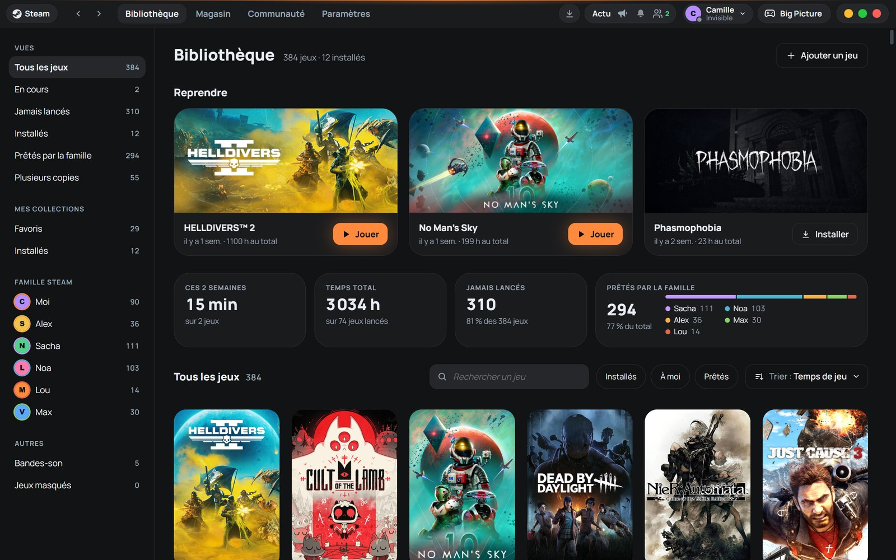
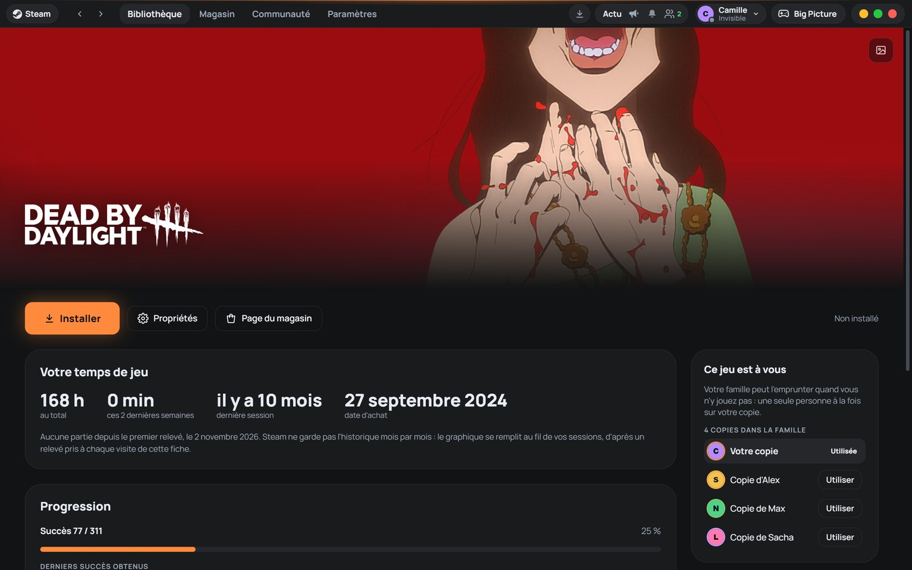
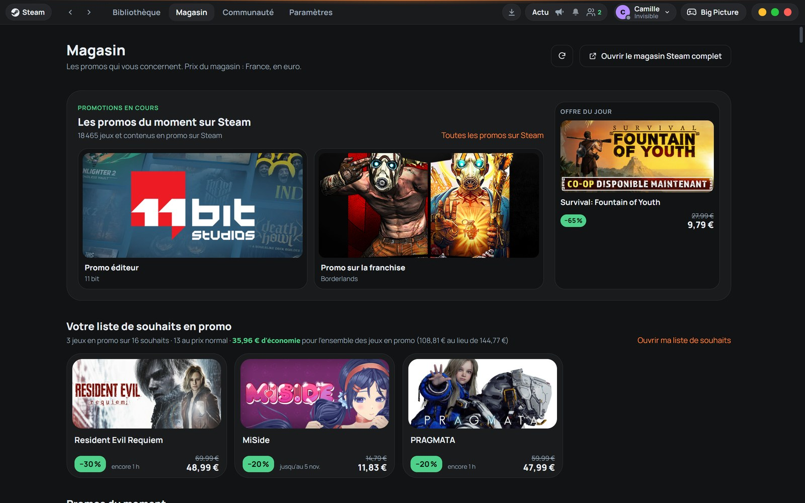
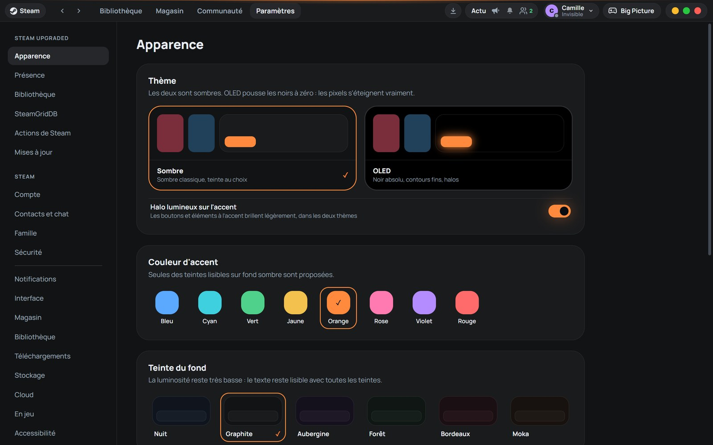
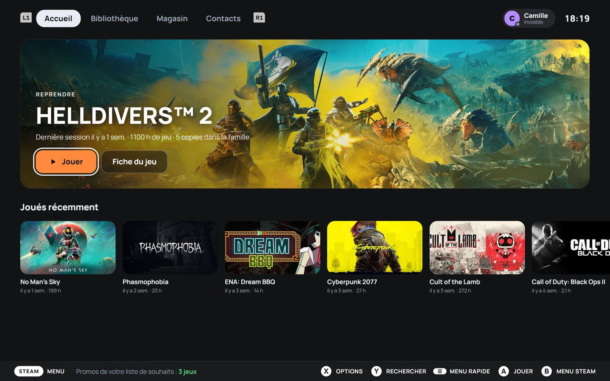
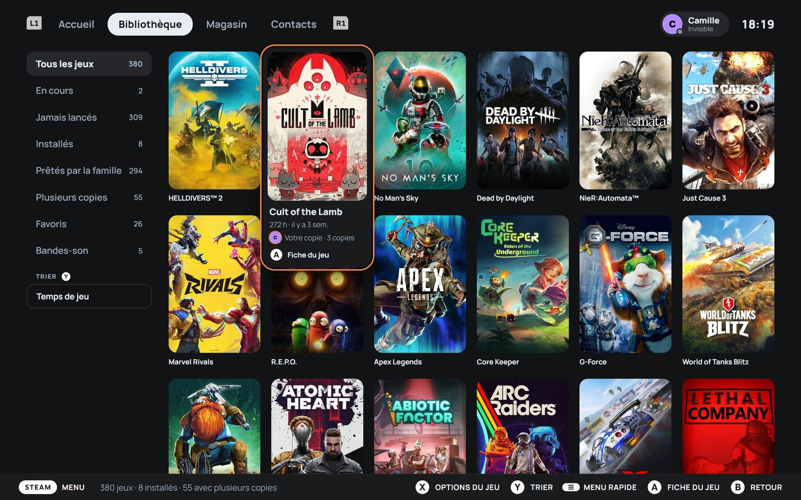
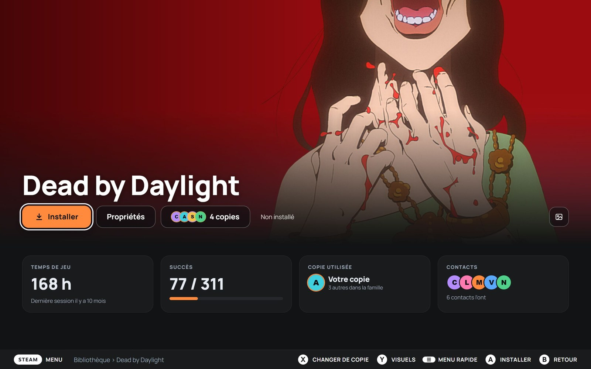
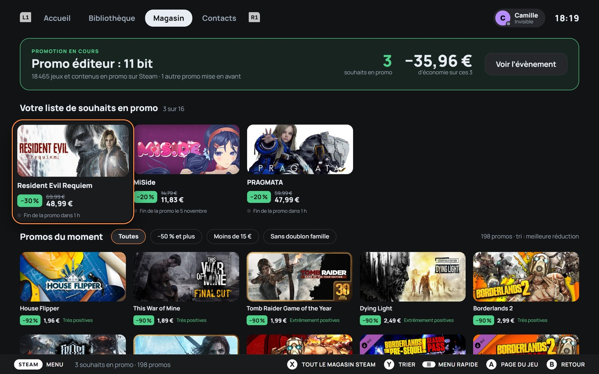

# Steam Upgraded

**Une nouvelle interface pour le client Steam, en mode bureau comme en Big Picture.** Powered by [Millennium](https://steambrew.app/).

*[English version](README.en.md)*

Steam Upgraded est un plugin pour Millennium qui remplace l'interface de Steam par une interface entièrement repensée, en français : bibliothèque, fiches de jeu, magasin, paramètres, téléchargements, contacts, Big Picture… Vos jeux, votre compte et vos réglages Steam ne changent pas : seul l'affichage change, et tout revient comme avant à la désinstallation.

> Projet indépendant, sans lien avec Valve. Steam est une marque de Valve Corporation.



<!-- Liens permanents vers la dernière version : chaque publication doit joindre ces deux fichiers, avec ces noms exacts. -->

## Télécharger

**Windows 10 et 11**, avec Steam installé :

- **[Télécharger l'installeur](https://github.com/venaciteam/steam-upgraded/releases/latest/download/Steam-Upgraded-Setup.exe)** : il s'occupe de tout, Millennium compris. En cas de doute, c'est celui-ci.
- **[Télécharger le plugin seul](https://github.com/venaciteam/steam-upgraded/releases/latest/download/com.venacity.steamupgraded.star)** : si Millennium est déjà installé (voir [Installation manuelle](#installation)).

Le message de Windows au premier lancement et les étapes : voir [Installation](#installation). Toutes les versions : [publications](../../releases).

| Fiche d'un jeu | Magasin | Paramètres › Apparence |
| --- | --- | --- |
|  |  |  |

**En Big Picture**

| Accueil | Bibliothèque |
| --- | --- |
|  |  |
| **Fiche d'un jeu** | **Magasin** |
|  |  |

## Ce que ça apporte

**En mode bureau**

- **Une seule barre en haut** : navigation, téléchargements, actualités, contacts et compte, au lieu des barres et menus empilés de Steam.
- **Bibliothèque** : vues prêtes à l'emploi (en cours, jamais lancés, installés, prêtés par la famille, plusieurs copies…), vos collections, les membres de votre Famille Steam, une rangée « Reprendre » et une grille de jaquettes qui s'agrandissent au survol.
- **Fiche de jeu** : bannière et logo, temps de jeu, succès, copies disponibles dans la famille (et choix de la copie utilisée), collections, contacts qui ont le jeu.
- **Magasin** : les promotions qui vous concernent, à commencer par celles de votre liste de souhaits, aux prix de votre pays.
- **Paramètres réunis** : ceux de Steam Upgraded et ceux de Steam dans une seule page.
- **Pages et fenêtres de Steam habillées** : téléchargements, menus, dialogues, propriétés, notifications, contacts et discussions, captures, bandes-son et lecteur de musique.
- **Transitions entre les pages** et ouverture animée, courtes, qui respectent le réglage « Animations réduites » de Windows.

**En Big Picture**

- Accueil, bibliothèque, fiches de jeu, magasin et page de vente, succès, téléchargements, recherche, médias, bandes-son, contacts et discussions : des écrans pensés pour la manette, avec les boutons de votre manette (Xbox, PlayStation…).
- Les menus et écrans de Steam restés natifs (paramètres, propriétés, menu Steam, accès rapide, clavier virtuel) sont habillés aux mêmes couleurs.

**Personnalisation**

- Deux thèmes sombres : **Sombre** et **OLED** (noir absolu).
- Huit couleurs d'accent et six teintes de fond, toutes choisies pour rester lisibles.
- Coins en « squircle », halo lumineux sur l'accent, prise en charge du HDR.
- **Visuels SteamGridDB** : jaquette, bannière, logo, capsule large et icône au choix pour chaque jeu, avec votre propre clé SteamGridDB (gratuite).

## Quelques choix assumés

- **Rien n'est jamais posé sur une jaquette** : pas de badge ni de texte, les informations vont dessous ou dans la carte qui s'affiche au survol.
- **Thèmes sombres uniquement.**
- **Les pages web de Valve** (Communauté, profils, magasin complet) restent d'origine : les reprendre casserait à chaque mise à jour de Valve.
- **Aucun chiffre inventé** : quand une donnée n'existe pas (historique des prix, par exemple), elle n'est pas affichée.

## Installation

Il faut Windows et Steam. L'installeur s'occupe du reste, Millennium compris.

1. Téléchargez **[`Steam-Upgraded-Setup.exe`](https://github.com/venaciteam/steam-upgraded/releases/latest/download/Steam-Upgraded-Setup.exe)** (dernière version).
2. Lancez-le. L'installeur n'est pas signé : Windows SmartScreen peut afficher « Windows a protégé votre ordinateur ». Cliquez alors sur « Informations complémentaires », puis « Exécuter quand même ».
3. Suivez les écrans. L'installeur vérifie Steam et Millennium, installe ou met à jour Millennium si besoin (version 3.6 ou plus récente, téléchargée depuis ses publications officielles et vérifiée), installe le plugin, puis relance Steam. Steam doit être fermé pendant l'installation : l'installeur vous le demande s'il est ouvert.

En cas d'échec, tout ce qui a été modifié est remis en place.

**Installation manuelle** (si Millennium est déjà installé) : copiez [`com.venacity.steamupgraded.star`](https://github.com/venaciteam/steam-upgraded/releases/latest/download/com.venacity.steamupgraded.star) (fourni dans chaque publication) dans le dossier `millennium\plugins` de Steam, puis activez « Steam Upgraded » dans les réglages de Millennium.

## SteamGridDB (facultatif)

Pour choisir d'autres visuels pour vos jeux, il faut une clé API SteamGridDB, personnelle et gratuite :

1. Créez un compte sur [steamgriddb.com](https://www.steamgriddb.com/).
2. Dans votre profil, ouvrez **Préférences › API** et générez une clé.
3. Collez-la dans l'installeur, ou plus tard dans **Paramètres › SteamGridDB** de Steam Upgraded.

La clé reste sur votre PC, dans la configuration de Millennium. Chaque personne utilise la sienne : le plugin n'en contient aucune.

## Mises à jour

Pour passer à une nouvelle version, téléchargez le nouvel installeur et lancez-le : il propose « Mettre à jour vers » la nouvelle version. Vos réglages, votre clé SteamGridDB et vos visuels personnalisés sont conservés.

La version installée est affichée dans **Paramètres › Mises à jour**. La mise à jour directement depuis ces paramètres arrivera dans une prochaine version.

## Désinstallation

- Depuis Steam : **Paramètres › Mises à jour › Désinstaller…** (vous pouvez garder vos réglages pour une réinstallation). Millennium reste installé.
- Ou depuis l'installeur : il propose « Désinstaller », avec l'option de retirer aussi Millennium s'il l'avait installé lui-même.

Dans les deux cas, Steam retrouve son interface d'origine.

## Confidentialité

Steam Upgraded ne collecte rien et n'envoie rien à son auteur. Il n'a pas de serveur. Il contacte uniquement :

- **Steam** (magasin, prix, liste de souhaits, images des jeux), comme le client Steam lui-même ;
- **SteamGridDB**, seulement si vous avez saisi une clé et que vous cherchez des visuels ;
- **Google Fonts**, pour charger la police Manrope de l'interface ;
- **GitHub**, depuis l'installeur uniquement, pour télécharger Millennium.

Vos réglages et les relevés de temps de jeu (qui servent au graphique de la fiche d'un jeu) restent sur votre PC.

## Pour développer

Prérequis : [Millennium](https://github.com/SteamClientHomebrew/Millennium) 3.6 ou plus récent, [Bun](https://bun.sh/) ou Node.js, et Rust pour l'installeur.

```bash
bun install        # dépendances (et types de Millennium)
bun run build      # compile le plugin et l'installe dans le Steam local
```

Lancez Steam avec `-dev` pour avoir les outils de développement de l'interface sur `http://127.0.0.1:8080`. Rechargez l'interface après une compilation.

L'installeur Windows (Tauri 2) se compile avec `bash installer/build.sh` et sort dans `installer/dist/`. Le mode `--simulation [vierge|ancien|installe|sans-steam|erreur-reseau|steam-bloque]` travaille dans un faux dossier Steam, sans toucher au vrai.

Organisation du code :

| Dossier | Contenu |
| --- | --- |
| `frontend/core/` | réglages, thème (couleurs `--sp-*`), accès aux données de Steam, historique et redirections, transitions |
| `frontend/shell/` | barre du haut, téléchargements, contacts, lecteur de musique |
| `frontend/pages/` | pages du mode bureau |
| `frontend/bigpicture/` | écrans et habillage de Big Picture |
| `frontend/features/` | SteamGridDB, paramètres de Steam intégrés, musique, désinstallation… |
| `backend/` | backend Lua (magasin, SteamGridDB, visuels, désinstallation) |
| `installer/` | installeur Windows (Rust + HTML) |

## Licence

[MIT](LICENSE) © 2026 Venacity
